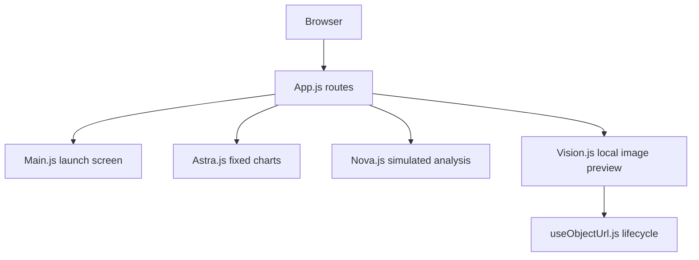
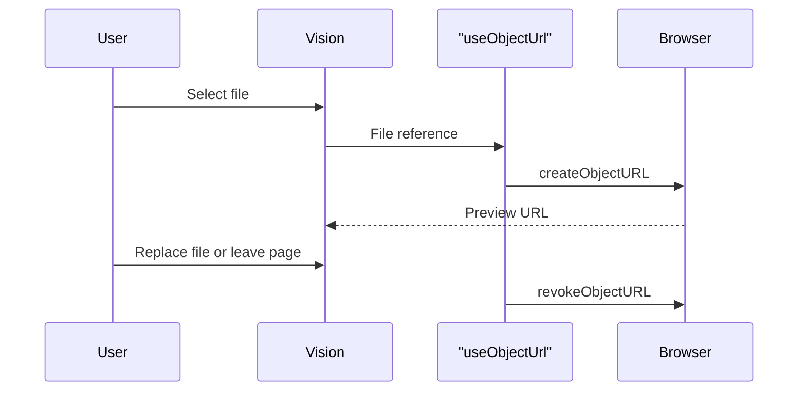

# Quantum AI Nexus: architecture and maintenance

Reviewed 11 November 2026 against master `cdbc8152a2f102831d24fceb8015924b91858036`; maintenance changes are AI-assisted. This is a React UI prototype. Astra charts use fixed arrays; Nova simulates analysis with a timer; Vision displays an image preview. There is no inference backend, database, upload service or quantum computation in this source.

## Implemented components

`frontend/src/index.js` mounts React; `App.js` selects routes. Recharts and local arrays produce Astra visualisations. React state owns text/options and selected files. `frontend/firebase.json` describes static hosting and a single-page fallback; its presence does not establish a current deployment. The original `Astra readme` explains possible predictive analytics applications, rather than an implemented ML pipeline.

## Resource and request boundaries

Previously each Vision render created an unreleased object URL. The hook now owns one URL per selection and releases it on replacement, removal and unmount. Main now clears its pending navigation timer on unmount and ignores repeated launches while navigation is pending. Image bytes remain local to the browser in this implementation.

## Reproduce and maintain

Run from `frontend/`: `npm ci --ignore-scripts --no-audit --no-fund`, `npm test -- --watchAll=false --runInBand`, then `CI=true npm run build`. The checked-in lockfile is authoritative; change it deliberately alongside dependency changes. The workflow runs these commands with a timeout and read-only repository permissions. CI treats lint warnings as errors; the maintained UI builds cleanly. The legacy build toolchain still emits dependency/deprecation notices and needs a separately tested migration.

The preview regression checks repeated renders, file replacement, removal and unmount. Test navigation across all three routes and image reselection before a release. Camera capture remains unavailable and is visibly disabled. Nova's analysis and Astra's numbers are demonstrations and must not be shown as real predictions.

## Scalability decisions and remaining work

Static assets can be delivered through a CDN, but no traffic capacity has been measured. Optimise the large bundled images and split route bundles after measuring transfer size and interaction latency. A future inference API needs server-side credentials, validated file/text limits, timeouts, bounded concurrency, authentication and cancellation. Keep API clients separate from presentation components and label failure, loading and unavailable states. Do not put provider keys in frontend environment variables. Establish browser accessibility checks, dependency review, a maintained build tool migration and real model evaluation before claiming production readiness.

See [frontend package configuration](../frontend/package.json), [routes](../frontend/src/App.js), [preview hook](../frontend/src/useObjectUrl.js) and [CI](../.github/workflows/frontend.yml).

